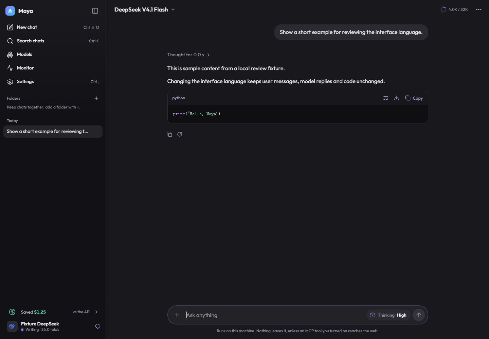
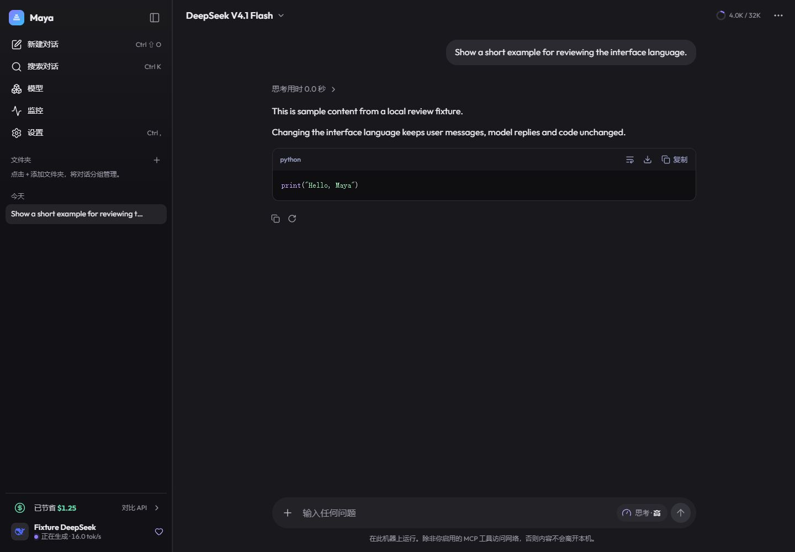
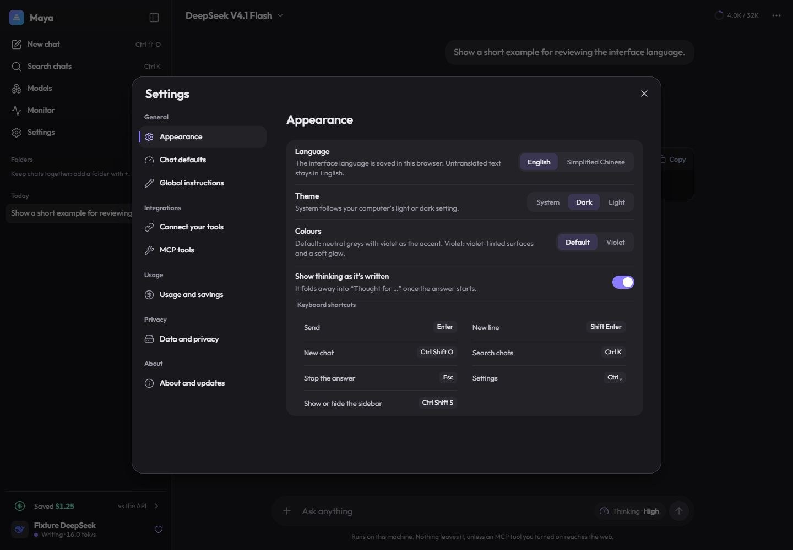
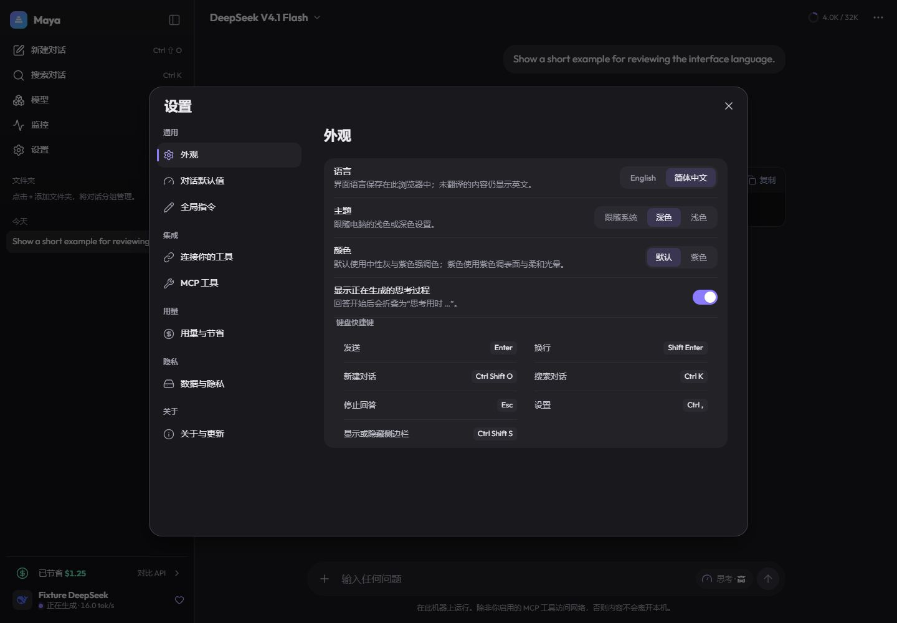
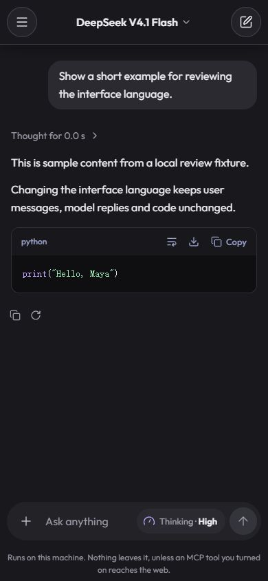
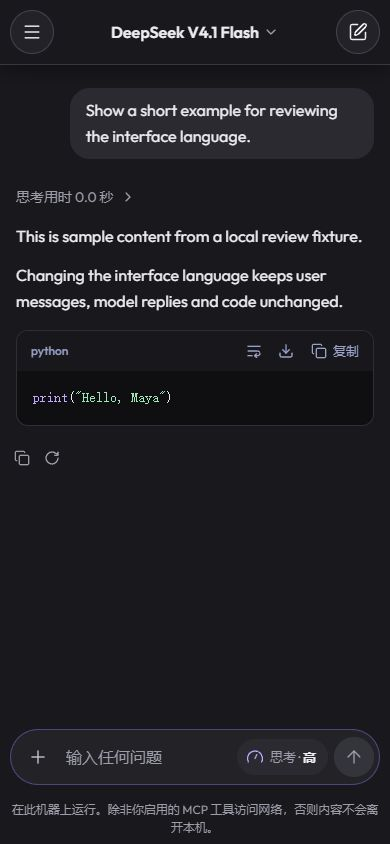
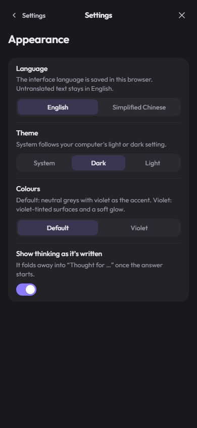
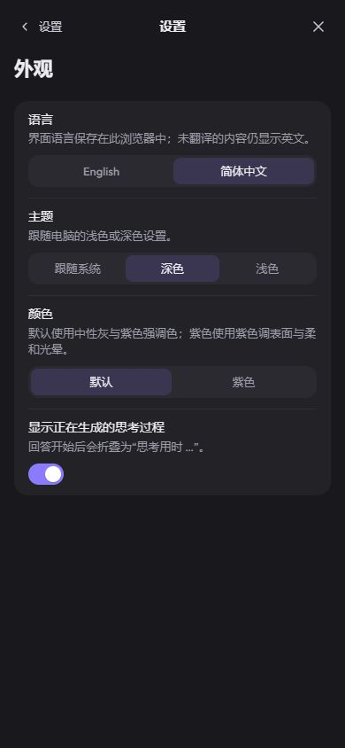

# PR #847 browser review evidence — 2026-11-09

Source: [mw00/project-maya PR #847](https://github.com/mw00/project-maya/pull/847), exact head `3daffa79cf83eb83ed28e9259c0f34eac2b4a284`.

## Environment and limits

- Windows desktop, installed Google Chrome build **156.0.8078.80** (from chrome.exe ProductVersion).
- Desktop viewport: **1440 × 1000 CSS pixels**.
- Narrow viewport: **390 × 844 CSS pixels**, using the same desktop Chrome with a viewport override.
- **No physical iPhone or Android device was tested.** This is responsive-layout simulation, not mobile Safari/Chrome, touch, soft-keyboard or on-device validation.
- Earlier acceptance used the Codex in-app browser; the fresh screenshots here are from installed Chrome.
- Real, unchanged PR Web modules served over loopback with invented API/SSE data. All displayed model names, metrics, paths and chat content are fixtures. No external forwarding or real inference.

## Focused checks

| View | English desktop | Chinese desktop | English narrow | Chinese narrow |
| --- | --- | --- | --- | --- |
| Chat with an existing answer/code block | Checked | Checked | Checked | Checked |
| Settings / Appearance | Checked | Checked | Checked | Checked |
| Monitor main view | Checked | Checked | Checked | Checked |
| Models main view | Checked | Checked | Checked | Checked |

Settings narrow navigation was checked from its page list into Appearance and back. Drawer navigation was exercised. Existing user/answer/code text stayed unchanged as the UI locale changed; English text inside the Chinese chat screenshots is intentional raw content.

In these views, document width matched viewport width (1440 or 390); no page-level horizontal overflow was observed. Captured console warning/error list was empty. The final eight screenshots were visually inspected for locale, clipping, alignment and matching page state; no product change was needed.

This was a bounded UI smoke pass, not exhaustive edge-state, accessibility or cross-browser certification. No automated suite was rerun, and no model download/switch/restart/deletion, production deployment or PR merge was performed. Task preview was stopped and its tab/viewport override cleaned up.

## Screenshots

| View | English | Simplified Chinese |
| --- | --- | --- |
| Chat — desktop |  |  |
| Settings — desktop |  |  |
| Chat — narrow simulation |  |  |
| Settings — narrow simulation |  |  |

The evidence branch is separate from the PR implementation branch. Metadata: [browser checks](browser-checks.json), [screenshot SHA256](screenshots.sha256.json).
